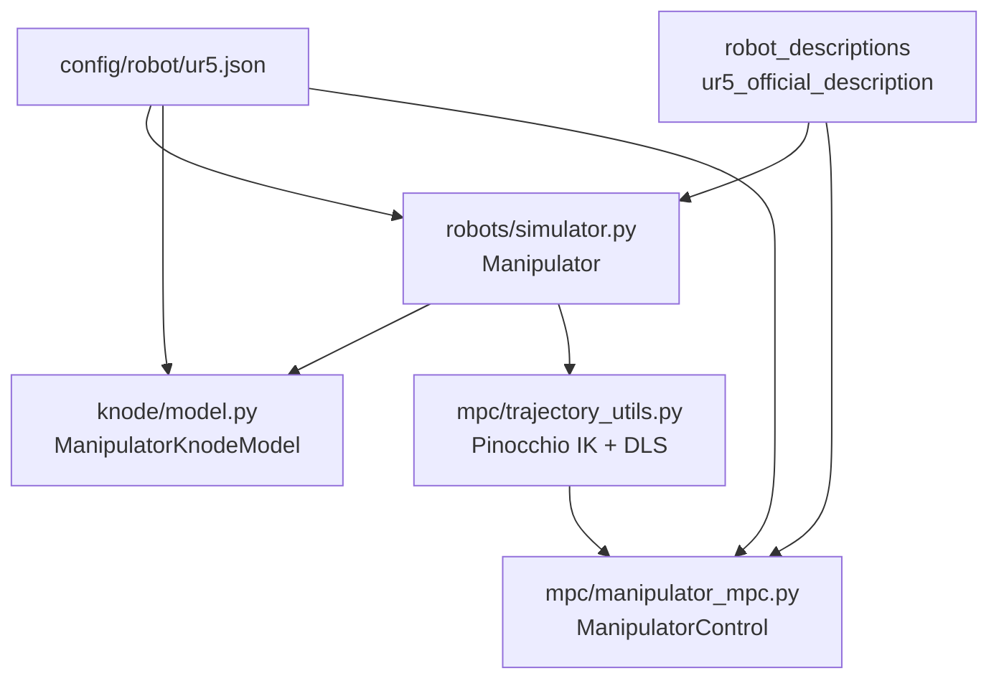

# Migration: Planar 2R → Universal Robots UR5 (6-DOF)

This document describes the first step of migrating from a 2-DOF planar arm to a full 6-DOF Universal Robots arm. Only the **robots**, **knode**, and **mpc** stacks were updated in this pass. Data collection (`utils/`), evaluation harnesses, and plotting utilities still target the planar arm and will be migrated next.

## Summary of Changes

| Component | Before (Planar 2R) | After (UR5 6-DOF) |
|-----------|-------------------|-------------------|
| Robot model | `robots/planar-2R.urdf` | `robot_descriptions.ur5_official_description` |
| Simulator class | `PlanarArm` (hardcoded 2-DOF) | `Manipulator` (n-DOF from URDF) |
| K-NODE state `z` | 6 = `[q(2), q̇(2), τ(2)]` | 18 = `[q(6), q̇(6), τ(6)]` |
| MPC state `x` | 4 = `[q(2), q̇(2)]` | 12 = `[q(6), q̇(6)]` |
| MPC control `u` | 2 torques | 6 torques |
| Task space | 2D `(x, y)` | 3D `(x, y, z)` position |
| Residual MLP | 2 → 128 → 128 → 2 | 6 → 128 → 128 → 6 |
| Gravity (plant) | `[0, -9.81, 0]` | `[0, 0, -9.81]` |
| Gravity (model mismatch) | `[-2, -12, 0]` | `[0, 0, -7.5]` |

## New Files

```
robots/loaders.py            # Loads models via robot_descriptions
robots/robot_config.py       # Config loader (description name, dims, limits)
config/robot/ur5.json        # UR5 parameters and defaults
config/mpc/ur5_basic.json    # MPC benchmark trajectories in UR5 workspace
docs/ur6-migration.md        # This document
```

## Architecture



## Robot Model (`robots/`)

### `Manipulator` class

The planar-specific `PlanarArm` is replaced by a general `Manipulator` that reads dimensions from Pinocchio:

- `nq`, `nv` inferred from URDF
- `ee_position(q)` → 3D position via Pinocchio FK
- `ee_jacobian(q)` → 3×6 position Jacobian
- RK4 / torchdiffeq integration unchanged, now n-DOF

`PlanarArm` is kept as a backward-compatible subclass for existing `utils/` code that still uses the 2R arm.

### UR5 model (`robot_descriptions`)

The UR5 is loaded through the [`robot_descriptions`](https://github.com/robot-descriptions/robot_descriptions.py) Python package — no vendored URDF in this repo:

```python
from robot_descriptions.loaders.pinocchio import load_robot_description
robot = load_robot_description("ur5_official_description")
```

Config field: `"description": "ur5_official_description"` in `config/robot/ur5.json`.

- **End-effector frame:** `tool0`
- **Caching:** first import downloads official xacro/URDF to `~/.cache/robot_descriptions/`
- **Deps:** `pip install robot_descriptions xacrodoc`

See [robots/README.md](../robots/README.md).

### Robot config (`config/robot/ur5.json`)

Centralizes robot-specific parameters so knode and MPC stay dimension-agnostic:

```json
{
    "name": "ur5",
    "description": "ur5_official_description",
    "ee_frame": "tool0",
    "nq": 6,
    "default_q": [0.0, -1.5708, 1.5708, 0.0, 1.5708, 0.0],
    "plant_gravity": [0.0, 0.0, -9.81],
    "model_gravity": [0.0, 0.0, -7.5],
    "torque_limits": [150, 150, 150, 28, 28, 28]
}
```

Load with:

```python
from robots.robot_config import load_robot_config
from robots.loaders import load_pinocchio_robot
from robots.robot_config import load_robot_config

cfg = load_robot_config("ur5")
robot = Manipulator(robot_config=cfg)
```

## K-NODE Learning (`knode/`)

### Model

- `ManipulatorKnodeModel` replaces `PlanarArmKnodeModel` (alias kept for compatibility)
- State layout: `z = [q₀…q₅, q̇₀…q̇₅, τ₀…τ₅]`
- Residual network: input = `q` (6D), output = Δq̈ (6D)
- Nominal dynamics: Pinocchio ABA inside `compute_nominal`
- Integration: piecewise RK4 with zero-order-hold torques (unchanged logic, generalized indices)

### Training

`knode/learn.py` now slices using `model.nq` and `model.mpc_state_dim` instead of hardcoded `4` and `6`.

Loss is still on `[q, q̇]` only (first 12 dimensions for UR5).

### Verification

```bash
python knode/verify_pin_grad.py
```

Confirms ZOH torque scheduling matches Pinocchio rollout on the UR5.

## MPC (`mpc/`)

### `ManipulatorControl`

- Reads `nx`, `nu`, torque limits, and URDF from robot config
- Nominal dynamics: Pinocchio CasADi ABA + Euler discretization
- KNODE mode: nominal ABA + residual NN via `ResidualNNCallback`
- MLP layer extraction is now dynamic (no hardcoded layer indices)

### Task-space tracking

`trajectory_utils.py` changes:

| Before | After |
|--------|-------|
| Analytic 2R FK | Pinocchio FK via `robot.ee_position` |
| `fsolve` on 2D residual | `scipy.optimize.least_squares` on 3D residual |
| Full Jacobian inverse | Damped least-squares pseudoinverse |
| 2D trajectories | 3D with optional `cz` height parameter |

Trajectory specs gain an optional `"cz"` field for the z coordinate (defaults to 0).

### Running MPC benchmarks

```bash
# Nominal dynamics only
python mpc/mpc_benchmark_harness.py --config ur5_basic --no-knode

# With learned KNODE model
python mpc/mpc_benchmark_harness.py \
    --config ur5_basic \
    --knode-path runs/<your_run>/checkpoints
```

## Running Training (after data migration)

Once UR5 training data exists (next migration step):

```bash
python run_experiment.py --dataset <ur5_dataset> --model basic1 --robot ur5
```

## What Is NOT Migrated Yet

These components still assume the planar 2R arm unless noted:

| Path | Status |
|------|--------|
| `utils/training_data_generator.py` | **Migrated** — UR5 6-DOF CTC + 3D IK |
| `utils/trajectory_generator.py` | **Migrated** — 3D trajectories + helix |
| `utils/visualize_trajectory.py` | **Migrated** — n-DOF joints + 3D matplotlib task space |
| `config/datasets_full_arm/*.json` | **Added** — UR5 dataset configs |
| `evaluate/benchmark_model.py` | Still planar |
| `config/datasets/*.json` | Planar configs (unchanged) |
| Existing planar `data/` | Unchanged |

The `PlanarArm` wrapper and `config/datasets/` remain for backward compatibility with planar experiments.

## Step 2: Data Collection & Visualization

### Dataset configs (`config/datasets_full_arm/`)

| Config | Description |
|--------|-------------|
| `ur5_demo.json` | Smoke test — 1 train + 1 test circle |
| `ur5_basic.json` | Circle, line, rectangle |
| `ur5_generalization.json` | Varied shapes + helix |

### Collect data

```bash
python utils/training_data_generator.py --config ur5_demo --split both
python run_experiment.py --dataset ur5_demo --model basic1 --robot ur5
```

### Visualization

Training and data collection now produce:
- Joint-space time series (q, q̇, q̈, τ) for all 6 joints
- **3D matplotlib** end-effector path plots (`projection="3d"`)
- Task-space x/y/z vs time comparison during K-NODE eval

## Known Limitations

1. **Position-only tracking** — EE orientation is not tracked; wrist joints resolve redundancy implicitly via IK seed continuity.
2. **No null-space control** — Redundant 6-DOF arm uses numerical IK without posture cost.
3. **Simplified URDF inertias** — Approximate masses/inertias; replace with official UR meshes for sim-to-real fidelity.
4. **Euler MPC discretization** — Same as planar; RK4 in optimizer is a future improvement.
5. **No self-collision constraints** — Joint limits only via torque bounds.

## Next Steps

1. Migrate `evaluate/benchmark_model.py` for 6-DOF rollouts
2. Add 6-DOF orientation tracking (SE(3) task space)
3. Null-space posture regularization tuning in IK and MPC
4. Replace simplified URDF with official UR description package
5. Benchmark MPC solve times at 6-DOF (may need shorter horizon or real-time iteration)

## Quick Reference: Dimension Cheatsheet

For a robot with `nq` joints:

| Symbol | Size | Contents |
|--------|------|----------|
| K-NODE state `z` | `3·nq` | `[q, q̇, τ]` |
| MPC state `x` | `2·nq` | `[q, q̇]` |
| MPC control `u` | `nq` | joint torques |
| Residual MLP in/out | `nq` | `q → Δq̈` |
| Task space (step 1) | 3 | `[x, y, z]` |

For UR5: `nq = 6`, so `z ∈ ℝ¹⁸`, `x ∈ ℝ¹²`, `u ∈ ℝ⁶`.
